<!-- _class: title -->
<!-- _paginate: false -->

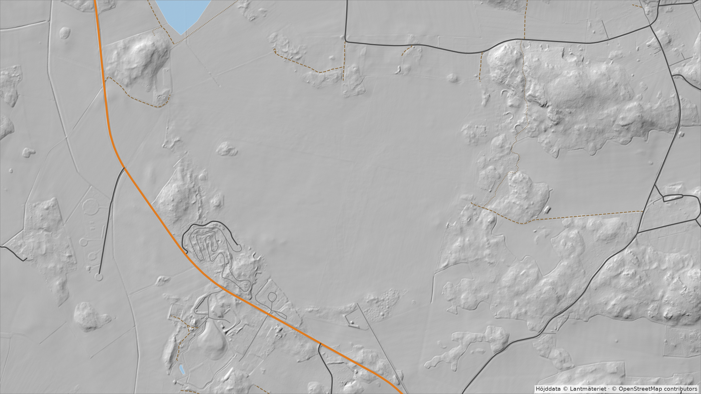

<div class="banner">

# mgis-layers

Kartlager och terrängprofiler för ett svenskt område

<span class="small">Python-bibliotek och CLI · github.com/dmarell/mgis-layers · Daniel Marell</span>

</div>

<!--
Bakgrunden är Skå-Edeby väster om Stockholm, ritad av biblioteket självt: Lantmäteriets höjdmodell som hillshade, med vatten och vägar ur OSM. Samma område används genom hela presentationen.
-->

---

# Vad finns på marken här?

<div class="cols-wide">
<div>

För ett område vill man kunna svara på:

- Hur högt ligger marken?
- Vad växer här, och hur högt är det?
- Var går vägar och stigar?
- Vilka hinder finns för den som flyger lågt?

Svaren finns, men hos **fyra källor** med olika format, inloggning och koordinatsystem.

</div>
<div>

<div class="box"><h3>Lantmäteriet</h3><p>Höjdmodell 1 m · STAC + GeoTIFF · konto på Geotorget · SWEREF99 TM</p></div>
<div style="height:10px"></div>
<div class="box"><h3>OpenTopoData</h3><p>Höjdmodell 30 m · öppet API, 1 anrop/s · WGS84</p></div>
<div style="height:10px"></div>
<div class="box"><h3>OpenStreetMap via Overpass</h3><p>Mark, vägar, hinder, byggnader, pistar · JSON · WGS84</p></div>
<div style="height:10px"></div>
<div class="box"><h3>Skogsstyrelsen</h3><p>Trädhöjd 1 m · FTPS, rutor om 2,5 km · SWEREF99 TM</p></div>

</div>
</div>

<!--
Problemet biblioteket löser: datan finns, men den är utspridd. Varje källa har sitt eget protokoll, sin egen inloggning och sitt eget koordinatsystem. mgis-layers gör en sak: hämtar allt för ett område till en katalog och svarar sedan på frågor om det, offline.
-->

---

# Begrepp: AOI, raster och vektor

<div class="cols" style="grid-template-columns: 0.75fr 1.6fr;">
<div>

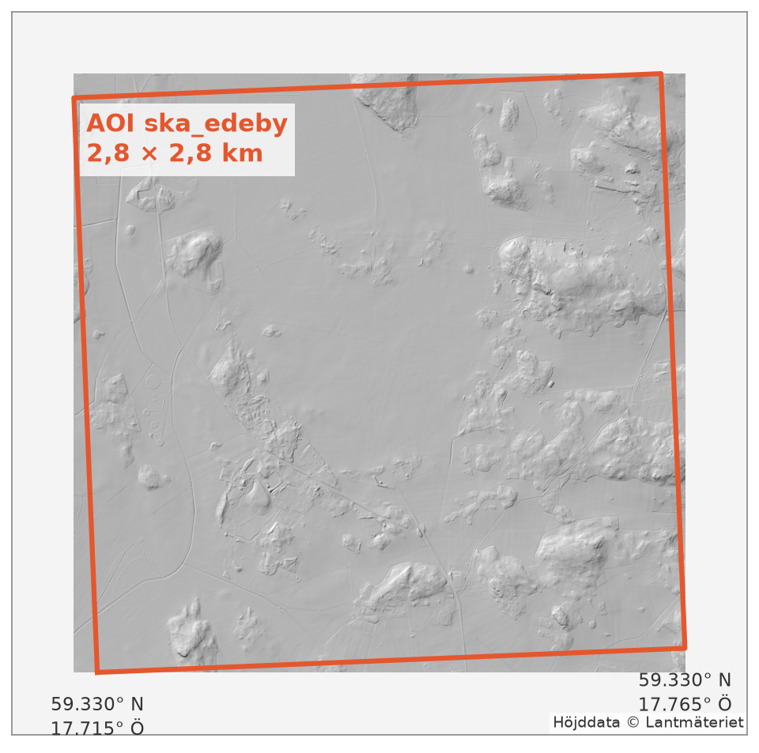

<div class="small">

**AOI** (area of interest): en rektangel i lat/lon ur en GeoJSON-fil. Alla lager hämtas för den.

</div>
</div>
<div>

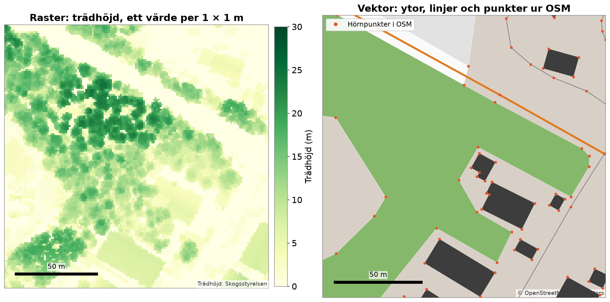

<div class="small">

**Raster:** ett rutnät med ett värde per ruta (höjd, trädhöjd).
**Vektor:** ytor, linjer och punkter med taggar (allt ur OSM).

</div>
</div>
</div>

<!--
AOI-filen kan innehålla vilken polygon som helst, men biblioteket använder bara dess omslutande rektangel.
Till höger samma 160 × 160 m två gånger. Rastret är Skogsstyrelsens trädhöjd: varje ruta är 1 × 1 m. Vektorerna är OSM: skogen är en yta, vägen en linje, och de röda prickarna är hörnpunkterna som någon har ritat in.
-->

---

# Jorden är inte platt

<div class="cols" style="grid-template-columns: 1fr 0.8fr 1fr;">
<div>

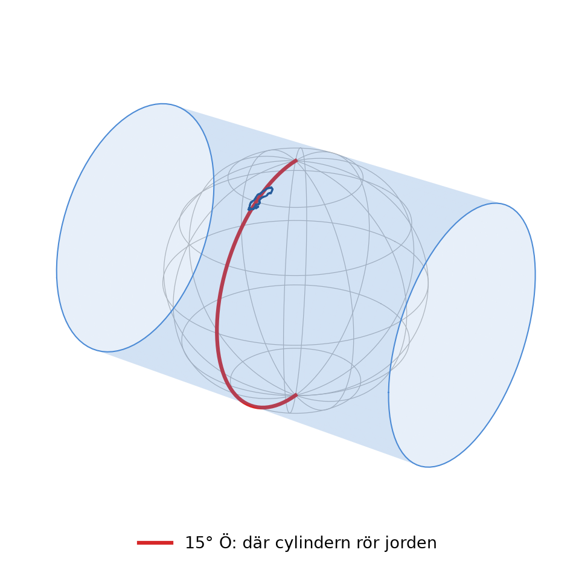

</div>
<div>

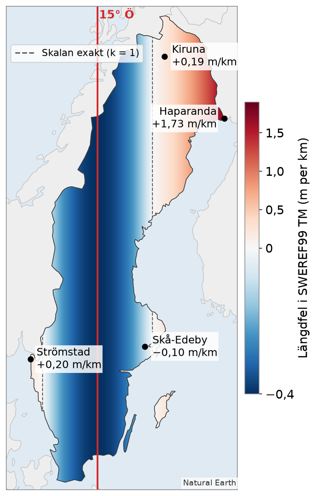

</div>
<div>

**SWEREF99 TM** är Sveriges plana koordinatsystem, i meter.

- En cylinder rör jorden längs **15°&nbsp;Ö**, med skalan 0,9996
- Skalan stämmer exakt cirka 180 km åt var sida
- Ju längre ut, desto större fel
- Skå-Edeby: **−0,10 m/km**
- Haparanda: **+1,73 m/km**

Ett system för hela Sverige, utan zongränser.

</div>
</div>

<!--
För att få ett plant rutnät i meter måste jordytan projiceras på ett plan. SWEREF99 TM är en transversal Mercatorprojektion: tänk en cylinder som ligger ner och rör jorden längs meridianen 15° Ö. Skalan är satt till 0,9996 där, 40 cm för kort per km, så att den stämmer exakt längs två linjer cirka 180 km åt var sida (de streckade).
Felet växer med avståndet från 15° Ö. Vid Skå-Edeby är en kilometer i rutnätet 10 cm för kort. Längst i öster, vid Haparanda, 1,7 m för lång.
-->

---

# Vad det betyder i ett AOI

<div class="cols-wide" style="grid-template-columns: 2.1fr 1fr;">
<div>

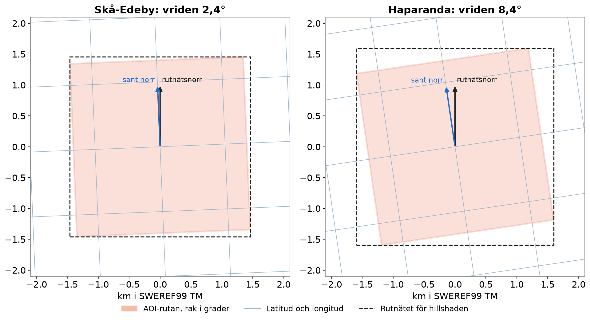

</div>
<div>

- Rutan är rak i grader men **vriden** i SWEREF99 TM: 2,4° vid Skå-Edeby, 8,4° vid Haparanda
- Hillshaden räknas på ett rakt rutnät som täcker **alla fyra hörnen**, och hörnen lämnas tillbaka i WGS84
- En rak linje i planet ligger **högst 5 cm** från den kortaste vägen på jorden över 10 km (13 cm vid Haparanda)

</div>
</div>

<!--
Meridianerna lutar mot varandra, så en ruta som är rak i lat/lon blir sned i det plana systemet. Vinkeln heter meridiankonvergens.
Därför räknar hillshade på ett rutnät som täcker hela den sneda rutan, och ger tillbaka hörnen i WGS84 i den ordning MapLibre vill ha dem. Kartan lägger då bilden rätt.
Terrängprofilen är en rak linje i planet. Den skiljer sig från den verkliga kortaste vägen med centimeter. Det spelar ingen roll för en profil.
-->

---

# Mät aldrig på webbkartan

<div class="cols-wide">
<div>

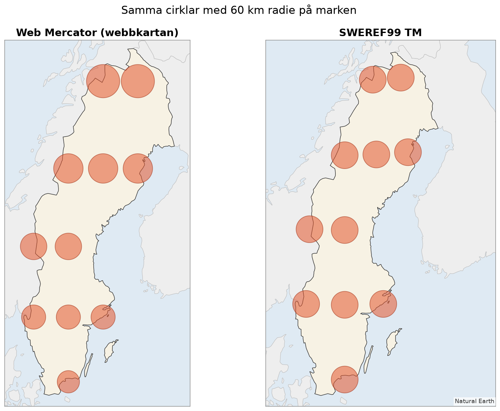

</div>
<div>

Webbkartor (Web Mercator) behåller formen men inte storleken.

- Vid Skå-Edeby är skalan **1,96 gånger** för stor
- Ytor ser **nästan fyra gånger** så stora ut
- I SWEREF99 TM är alla cirklarna lika stora

mgis-layers räknar alla avstånd i SWEREF99 TM, aldrig i skärmkoordinater.

</div>
</div>

<!--
Alla cirklarna har radien 60 km på marken. I webbkartan växer de mot norr: skalan är 1/cos(latitud), vid 59° ungefär 2. I SWEREF99 TM är de lika stora, felet där är bara promille.
Det är därför biblioteket tar in och lämnar ut WGS84, men räknar allt i SWEREF99 TM.
-->

---

# Hanterar och hanterar inte

<div class="cols">
<div>

## Hanterar

<div class="ok">

- Alla avstånd och steg i **meter** i SWEREF99 TM, lika långa på marken
- In och ut i **WGS84**; projektionen syns inte för den som anropar
- Hillshaden i rätt läge på en webbkarta

</div>

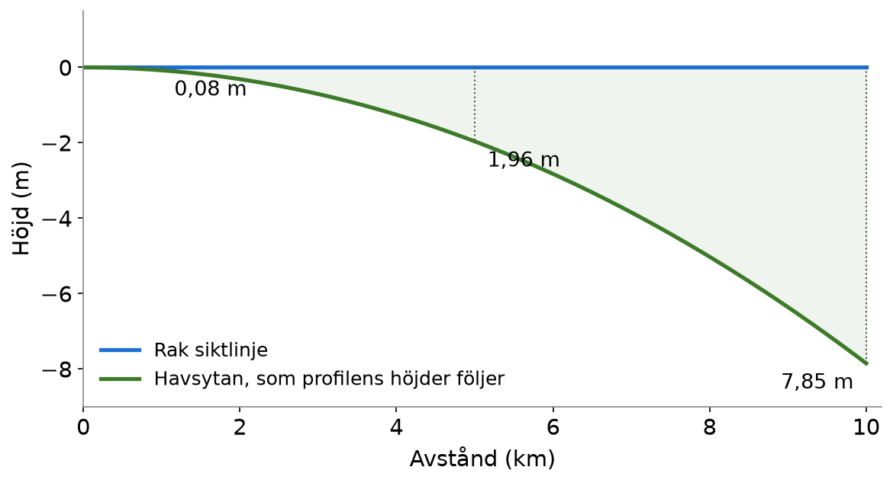

</div>
<div>

## Hanterar inte

<div class="no">

- **Skalfaktorn:** längder är rutnätsmeter, −0,1 till +1,7 m/km
- **Den kortaste vägen:** profilen är rak i planet, några cm på 10 km
- **Jordkrökningen:** höjderna följer havsytan. Fri sikt får man räkna själv: 2 m på 5 km
- **Höjdsystem:** höjd över havet (RH 2000). GNSS ger höjd över ellipsoiden, **23,6 m** högre vid Skå-Edeby (20–37 m i Sverige)
- **Utanför Sverige:** SWEREF99 TM gäller bara här

</div>
</div>
</div>

<!--
Det viktiga är att felen är kända och små där de inte hanteras.
Jordkrökningen: en profil är höjder över havet längs marken. Den som vill veta om man ser B från A måste själv lägga till krökningen, kurvan nere till vänster.
Höjdsystemet är den fälla som är lättast att gå i: en GPS ger höjd över ellipsoiden. Vid Skå-Edeby ligger den 23,6 m över RH 2000 (Lantmäteriets geoidmodell SWEN17). Biblioteket räknar inte om mellan dem.
-->

---

# Översikt

<div style="display:grid; grid-template-columns: 1fr 46px 1.15fr 46px 1.3fr; gap: 8px; align-items: stretch;">
<div class="box"><h3>Källorna</h3><p>Lantmäteriet<br>OpenTopoData<br>Overpass (OSM)<br>Skogsstyrelsen</p></div>
<div class="arrow">→</div>
<div class="box"><h3><code>gis-layers fetch</code></h3><p>Hämtar en gång till en katalog per AOI:</p>
<pre style="font-size:14px; padding:8px; margin-top:6px"><code>aoi.json
elevation/dem.tif
osm/landuse_…geojson
osm/roads_…geojson
osm/infra_…geojson
treeheight/chm.tif</code></pre></div>
<div class="arrow">→</div>
<div class="box"><h3>Lagren, offline</h3><p>
<code>height_at(punkt)</code> höjd<br>
<code>landuse_at(punkt)</code> markanvändning<br>
<code>nearest_road</code>, <code>roads_near</code><br>
<code>features_near(punkt, radie)</code> hinder<br>
<code>height_at</code> trädhöjd</p></div>
</div>

<div style="height:20px"></div>

<div class="cols">
<div>

**Ovanpå lagren**

- `terrain_profile(a, b)`: höjd och mark längs en linje
- `hillshade(höjd, bbox)`: PNG och hörn för kartan
- Klassning: `landuse_label`, `road_properties`, `infra_properties`, `building_properties`

</div>
<div>

```bash
gis-layers fetch --aoi aoi.geojson \
    --out data/ska_edeby \
    --layers elevation,landuse,roads,infra,treeheight
```

<span class="small">`fetch` hämtar och cachar, `from_geojson` och `load_elevation` läser offline.</span>

</div>
</div>

<!--
Två steg. Först hämtar fetch allt över nätet till en katalog. Sedan läses lagren därifrån utan nät, och varje lager svarar på en fråga om en punkt.
Ovanpå lagren finns profilen, hillshaden och klassningsfunktionerna. Klassningen är samma kod som frågorna använder, så en karta visar exakt det som frågorna svarar.
-->

---

# Höjdmodellen: 30 m eller 1 m

<div class="center">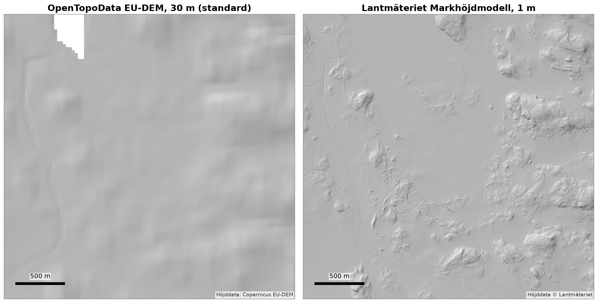</div>

<div class="cols small" style="margin-top:6px">
<div><strong>Standard:</strong> OpenTopoData EU-DEM, öppet, ett <code>dem.tif</code> per AOI. Hålet uppe till vänster är en sjö, där EU-DEM saknar värden.</div>
<div><strong>Tillval:</strong> Lantmäteriet Markhöjdmodell 1 m. Kräver konto på Geotorget och rutor om 10 × 10 km (cirka 250 MB styck).</div>
</div>

<!--
Samma område, samma belysning. Till vänster den öppna modellen som är standard: inget konto, men 30 m mellan punkterna. Till höger Lantmäteriets laserskannade modell med 1 m: diken, vägbankar och de små bergknallarna syns.
Båda läses via load_elevation, som väljer läsare efter vad som ligger i katalogen.
-->

---

# De andra lagren

<div class="cols-wide" style="grid-template-columns: 2.6fr 1fr;">
<div>

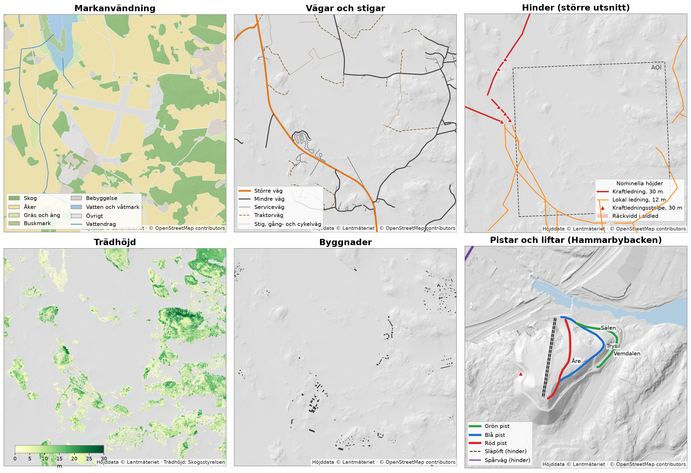

</div>
<div class="small">

**Markanvändning** `landuse_at`
OSM `landuse`, `natural`, vattendrag

**Vägar** `nearest_road`, `roads_near`
OSM `highway`, skoterleder

**Hinder** `features_near`
Ledningar, master, vindkraftverk, järnväg, liftar. Höjd, räckvidd, korridor

**Trädhöjd** `height_at`
Skogsstyrelsen, 1 m

**Byggnader** `building_properties`
Fotavtryck, höjd och våningar när de är taggade

**Pistar**
Nedfarter och skidspår, som GeoJSON

</div>
</div>

<!--
Ett lager per ruta. Alla rutor utom pistarna är Skå-Edeby; pistarna är Hammarbybacken eftersom Skå-Edeby saknar backar.
Hinder: ingen av de 18 ledningarna och stolparna i området har en height-tagg i OSM, så alla har nominella höjder per sort: 30 m för kraftledningar, 12 m för lokala ledningar. Hinderrutan visar ett större utsnitt eftersom de stora ledningarna går strax utanför AOI:n.
I Hammarbybacken syns att hinderlagret också tar med liftarna och Tvärbanan.
-->

---

# Allt tillsammans

<div class="cols-wide" style="grid-template-columns: 1.5fr 1fr;">
<div>

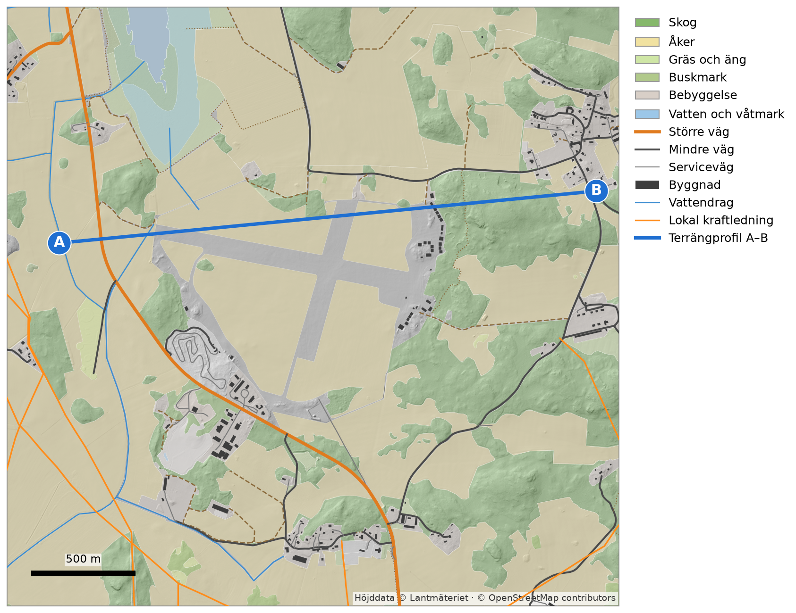

</div>
<div>

- `hillshade` ger bakgrunden
- Lagren ritas ovanpå med samma klassning som frågorna använder
- Linjen A–B är terrängprofilen på nästa bild

<div class="small" style="margin-top:18px">

Flygfältet syns som ett hål i markanvändningen: `aeroway` ingår inte i frågan mot Overpass.

</div>
</div>
</div>

<!--
Här ligger allt utom trädhöjden i samma karta. Den blå linjen från A till B går från åkrarna i väster, över flygfältet och upp över skogskullen i öster.
Flygfältet är grått eftersom det saknar markanvändning i lagret; aeroway hämtas inte.
-->

---

# Terrängprofil

<div class="cols" style="grid-template-columns: 1fr 1.25fr; gap: 22px;">
<div>

```python
from gis_layers import (LatLon, OsmLanduseProvider,
                        load_elevation, terrain_profile)

elevation = load_elevation("data/ska_edeby/elevation")
landuse = OsmLanduseProvider.from_geojson(
    "data/ska_edeby/osm/landuse_ska_edeby.geojson")

profile = terrain_profile(
    LatLon(59.3457, 17.7187), LatLon(59.3470, 17.7645),
    step_m=2.0, elevation=elevation, landuse=landuse,
)
for s in profile.samples[::250]:
    print(f"{s.distance_m:5.0f} m  {s.elevation_m:5.1f} m"
          f"  {s.landuse}")
```

<pre style="font-size:15px; margin-top:8px"><code>    0 m    3.3 m  landuse=farmland
  500 m    4.2 m  None
 1000 m    3.3 m  landuse=farmland
 1500 m    3.1 m  landuse=farmland
 2000 m   27.0 m  landuse=forest
 2500 m   15.5 m  landuse=farmland</code></pre>

</div>
<div>

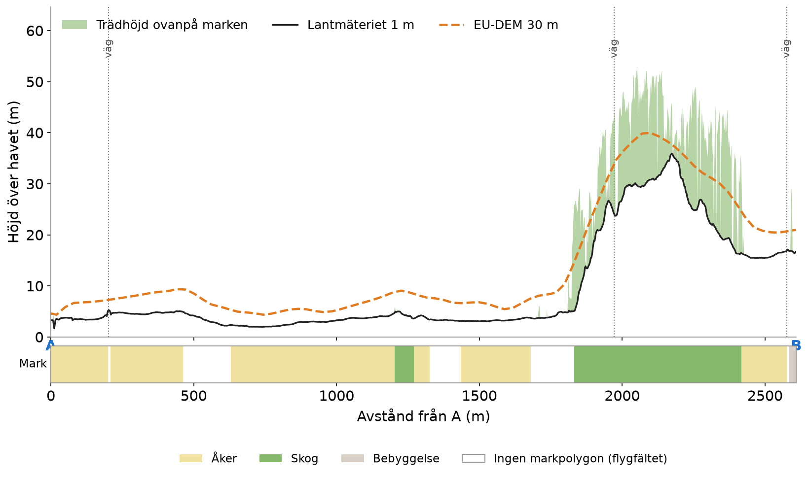

<div class="small">

Samma från kommandoraden: `gis-layers profile --from … --to …`.
EU-DEM ligger 3–4 m över Lantmäteriet på åkrarna; dess angivna noggrannhet är ±7 m.

</div>
</div>
</div>

<!--
Profilen tar vilka lager som helst; utan landuse blir det bara höjd. Punkterna ligger på lika avstånd på marken eftersom linjen delas upp i SWEREF99 TM.
I diagrammet: svart är Lantmäteriets 1 m, streckat orange EU-DEM 30 m. Den öppna modellen jämnar ut kullen och ligger några meter för högt på åkrarna, inom sin noggrannhet.
Trädhöjden ovanpå marken och vägkorsningarna har anroparen lagt till med height_at och nearest_road längs samma punkter.
-->

---

# Gränser

<div class="cols">
<div>

- **Bara Sverige:** SWEREF99 TM, Lantmäteriet och Skogsstyrelsen
- **AOI:n är en rektangel:** polygonen i GeoJSON-filen används inte
- **OSM är så bra som taggningen:** hinderhöjder är oftast nominella, och det som inte är ritat finns inte
- **Trädhöjden har en ålder:** senaste skanningen per ruta (här 2021)

</div>
<div>

**Licenser**

- Koden: MIT
- OSM: © OpenStreetMap contributors, ODbL
- Höjd: © Lantmäteriet; Copernicus EU-DEM
- Trädhöjd: Skogsstyrelsen

<div class="small" style="margin-top:14px">

Källhänvisningen följer med varje karta som visar datan.

</div>
</div>
</div>

<!--
De här gränserna är medvetna. En rektangel räcker för att hämta data, och den som behöver en polygon kan klippa själv.
Den största osäkerheten är OSM: hinder som ingen ritat in finns inte i lagret, och höjderna är nominella när taggen saknas.
-->

---

<!-- _paginate: false -->

# Frågor

<div style="height:30px"></div>

```bash
pip install "gis_layers @ git+https://github.com/dmarell/mgis-layers@v0.1.0"
gis-layers fetch --aoi examples/aoi_ska_edeby.geojson --out data/ska_edeby
```

<div style="height:30px"></div>

**github.com/dmarell/mgis-layers**

<span class="muted">Bilderna i presentationen görs av `presentation/make_figures.py` från den hämtade datan.</span>
